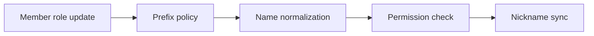

# Discord Role Prefix Manager

**Role-derived nickname normalization for RP factions and teams**

  

> **Documentation-only portfolio case study.** The source under [`src/public_interface.py`](src/public_interface.py) is intentionally unimplemented and raises `NotImplementedError`. This is **not** a runnable bot, a deployment package or independently verified production evidence.

## Why this module exists

Roleplay communities often encode a group or clan in a member's nickname. Automated prefix updates become tricky when roles change, users edit their own names, or existing nicknames already contain a managed prefix.

**Technology context:** Python, discord.py, role events, JSON settings. These technologies describe the private module's documented domain; public executable implementation is not provided.

## Workflow at a glance

1. Observe a relevant role or member update
2. Resolve which configured prefix, if any, should apply
3. Strip only the previously managed prefix from the display name
4. Respect exclusions and Discord nickname length/permission limits
5. Apply the new name and save the mapping change if needed

These stages summarize the public project description; the exact runtime and private integration details cannot be independently verified from the public skeleton.

## Engineering challenges

| Topic | Why it matters | How it should be verified |
|---|---|---|
| Update loops | Changing a nickname may trigger another member update | Make normalization idempotent |
| Role precedence | Members can hold multiple eligible roles | Define and test a stable priority order |
| Permission limits | Discord may prevent editing some members | Record failures without retry storms |
| User name integrity | Unmanaged parts of the nickname must not be lost | Use a reversible base-name strategy |

## Component boundary

This diagram is **conceptual**, not a snapshot of private production architecture. See the [design notes](docs/ARCHITECTURE.md) for boundaries, failure scenarios and test ideas.

## Repository contents and status

- [`src/public_interface.py`](src/public_interface.py) — non-runnable, documented public interface skeleton
- [`docs/ARCHITECTURE.md`](docs/ARCHITECTURE.md) — engineering design notes (no operational secrets)
- [`examples/config.example.jsonc`](examples/config.example.jsonc) — illustrative configuration shape, **not** a production configuration
- [`NOTICE.md`](NOTICE.md) and [`SECURITY.md`](SECURITY.md) — publication/security boundary

**Portfolio role:** Feature-level showcase of a private role/nickname automation module. No public tests, executable deployment or usage metrics are claimed here. For verifiable code, inspect the [FastAPI backend demo](https://github.com/Scumbagsss/priority-access-bot), [ticket workflow](https://github.com/Scumbagsss/advanced-discord-ticket-bot) and [monitoring pipeline](https://github.com/Scumbagsss/dayz-server-monitor-bot).

**Related systems:** [discord-nickname-request-bot](https://github.com/Scumbagsss/discord-nickname-request-bot) · [BOT](https://github.com/Scumbagsss/BOT).

**Contact:** Discord `scumbagsss` · Telegram [@dilarion](https://t.me/dilarion)
